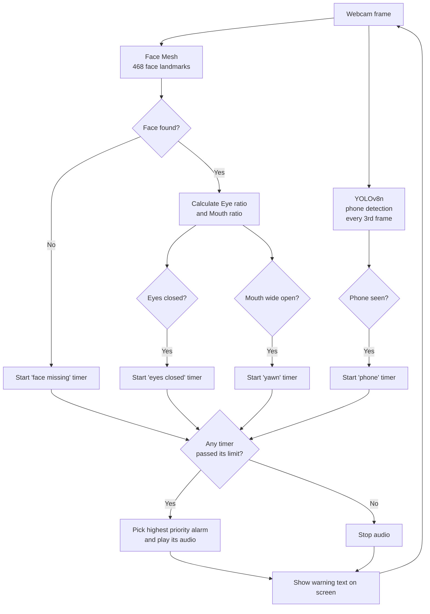

# 📚 Smart Study Monitor

A real-time AI study assistant that watches you through your webcam while you study and plays a **different audio warning** when you lose focus.

It detects four situations:

| Situation | How it is detected | Default trigger | Audio file |
|---|---|---|---|
| 😴 Sleeping | Both eyes stay closed | 2 seconds | `alarm.mp3` |
| 🚶 Out of frame | No face found in the camera | 3 seconds | `faudio.mp3` |
| 📱 Using a mobile phone | Phone found in the camera frame | 1.5 seconds | `paudio.mp3` |
| 🥱 Yawning | Mouth stays wide open | 1.2 seconds | `yawn.mp3` |

Everything runs **locally on your computer**. No video is recorded, saved, or sent anywhere.

---

## 🧠 How it works

The program reads the webcam in a loop. For every frame it runs two kinds of detection, then decides which alarm (if any) should play.



### 1. Face detection (sleep, yawn, out of frame)

The app uses **MediaPipe Face Mesh** (through the `cvzone` wrapper) to find 468 landmark points on the face.

- **Out of frame:** if no face is found for 3 seconds, the "come back" alarm plays.
- **Sleeping:** the app measures how open each eye is.

  ```
  Eye ratio = (eye height / eye width) × 100
  ```

  The ratio of the left and right eye is averaged. When it drops below `EYE_CLOSED_RATIO` and stays there for 2 seconds, the sleep alarm plays.
- **Yawning:** the app measures how open the mouth is.

  ```
  Mouth ratio (MAR) = lip height / mouth width
  ```

  When it stays above `YAWN_MAR` for 1.2 seconds, the yawn alarm plays. While the mouth is wide open, the sleep check is paused, because eyes squint during a yawn and would otherwise look like sleeping.

### 2. Phone detection

The app uses **YOLOv8n** (the smallest YOLO model, trained on the COCO dataset) and looks only for the `cell phone` class (class ID 67). To keep the CPU usage low, detection runs on **every 3rd frame**. A purple box is drawn around the phone.

### 3. Time-based triggers

Every check uses a **timer in seconds**, not a frame count, so it behaves the same on a slow or fast webcam. A short blink, a quick glance away, or a brief mouth movement does not trigger an alarm. The condition must continue for the whole time limit.

### 4. Alarm priority

If more than one problem happens at once, only one audio plays, in this order:

```
Out of frame  >  Sleeping  >  Yawning  >  Phone
```

As soon as you fix the problem (open your eyes, sit back in frame, put the phone down), the audio stops immediately. If a different problem starts, the audio switches to the new one.

---

## 🛠️ Tools and libraries used

| Tool | Purpose |
|---|---|
| **Python 3.11** | Main language |
| **OpenCV** (`opencv-python`) | Reads the webcam and shows the live window |
| **MediaPipe** | Face Mesh landmarks (eyes and mouth points) |
| **cvzone** | Easy wrapper over OpenCV and MediaPipe, used for face mesh and on-screen text |
| **Ultralytics YOLOv8** | Object detection for mobile phones |
| **pygame** | Plays the alarm audio files |

---

## 📁 Project structure

```
Smart_Study_Monitor/
├── app.py                # Main program (all the detection logic)
├── start_monitor.bat     # Launcher used by the desktop shortcut (Windows)
├── create_shortcut.py    # Creates the desktop shortcut (Windows)
├── alarm.mp3             # Audio: sleeping
├── faudio.mp3            # Audio: out of frame
├── paudio.mp3            # Audio: using phone
├── yawn.mp3              # Audio: yawning
├── yolov8n.pt            # YOLO model (downloaded automatically if missing)
└── README.md
```

> `face_landmarker.task` and `hand_landmarker.task` are leftovers from an earlier version and are not used by the current `app.py`.

---

## 🚀 Installation

### Requirements

- A computer with a **webcam**
- **Python 3.9 to 3.12** (tested on Python 3.11).
  Python 3.13 is **not recommended**, because MediaPipe does not provide official support for it.
- An internet connection for the first run (to download the YOLO model)

### Steps

1. **Download the project**

   ```bash
   git clone <your-repo-link>
   cd Smart_Study_Monitor
   ```

2. **Install the libraries**

   ```bash
   pip install opencv-python cvzone mediapipe==0.10.14 ultralytics pygame
   ```

   On Windows with several Python versions installed, use:

   ```bash
   py -3.11 -m pip install opencv-python cvzone mediapipe==0.10.14 ultralytics pygame
   ```

   > `mediapipe==0.10.14` is pinned on purpose. Newer versions can break the `cvzone` face mesh module.

3. **Check the audio files.** Make sure all four audio files (`alarm.mp3`, `faudio.mp3`, `paudio.mp3`, `yawn.mp3`) are in the same folder as `app.py`.

4. **Run the app**

   ```bash
   python app.py
   ```

   On Windows with several Python versions: `py -3.11 app.py`

   Press **`q`** in the camera window to quit.

> **Note:** `yolov8n.pt` is downloaded automatically on the first run. If the file in the folder is corrupt (very small, only a few bytes), delete it and run again.

---

## 🖥️ Desktop shortcut (Windows)

You can start the monitor with one double-click, without opening any code editor.

1. Open `start_monitor.bat` and make sure the Python command matches your setup (for example `py -3.11 app.py`).
2. Run this once:

   ```bash
   python create_shortcut.py
   ```

3. A **Smart Study Monitor** icon appears on your Desktop. Double-click it to start.

To make it start when Windows boots, press `Win + R`, type `shell:startup`, and copy the shortcut into that folder.

> If you move or rename the project folder, run `create_shortcut.py` again.

---

## ⚙️ Settings

All settings are at the top of `app.py`.

| Setting | Default | Meaning |
|---|---|---|
| `EYE_CLOSED_RATIO` | `11.0` | Eye ratio below this value counts as "eyes closed" |
| `SLEEP_SECONDS` | `2.0` | How long eyes must stay closed to count as sleeping |
| `AWAY_SECONDS` | `3.0` | How long no face is seen to count as out of frame |
| `PHONE_SECONDS` | `1.5` | How long a phone must be visible to trigger the alarm |
| `YAWN_MAR` | `0.60` | Mouth ratio above this value counts as "mouth wide open" |
| `YAWN_SECONDS` | `1.2` | How long the mouth must stay open to count as a yawn |
| `PHONE_CONF` | `0.5` | YOLO confidence needed to accept a phone detection |
| `YOLO_EVERY_N_FRAMES` | `3` | Run phone detection once every N frames |

### How to tune it for your face

The live window shows your current **Eye** and **Mouth** values at the top left.

- **Sleep alarm does not trigger:** note your Eye value with eyes open and with eyes closed, then set `EYE_CLOSED_RATIO` between them.
- **Yawn alarm does not trigger, or triggers while talking:** yawn once, watch the Mouth value, and set `YAWN_MAR` a little below it.
- **Phone is missed:** lower `PHONE_CONF` to `0.4`.

To change an alarm sound, replace the audio file or edit the file names in the `ALARMS` section of `app.py`.

---

## ❗ Troubleshooting

| Problem | Fix |
|---|---|
| `ModuleNotFoundError` | The libraries are not installed. Run the install command again. |
| `No matching distribution found for mediapipe` | Your Python version is too new. Use Python 3.11. |
| `python` or `pip` is not recognized | Python is not on PATH. Reinstall it and tick "Add python.exe to PATH". |
| Camera window is black or does not open | Close other apps using the webcam (Zoom, Teams, browser). Try `cv2.VideoCapture(1)` in `app.py`. |
| Error about `yolov8n.pt` | Delete the file. It will be downloaded again on the next run. |
| No sound | Check the volume and make sure the audio files are in the same folder as `app.py`. |

---

## ⚠️ Limitations

- Looking down at a book can look similar to closed eyes. Tune `EYE_CLOSED_RATIO` for your setup.
- A phone held below the camera view cannot be seen.
- Good lighting and a camera at eye level give the best results.
- Only one person (one face) is tracked at a time.

---

## 🔮 Ideas for future improvements

- Log study time and distraction count per session
- Daily report with a focus score
- Head pose detection (looking away from the screen)
- Pomodoro timer integration
- Simple settings window instead of editing the code

---

## 🔒 Privacy

All processing happens on your own device. Frames are analysed live and are never saved or uploaded.
